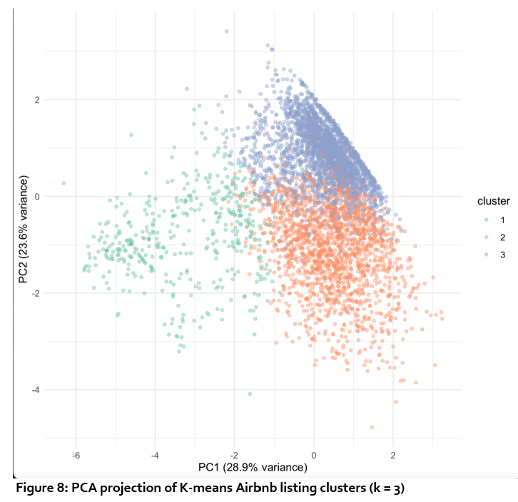
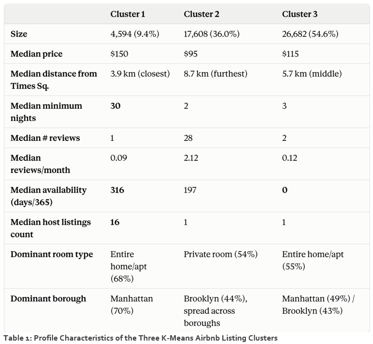

# Unit 6 - Team Project: Airbnb prices in New York City

[← Back to e-portfolio](../../README.md)

**Team F, Group 4:** Damiano Tartarini, Adaeze Ugochukwu, Jeroen Vreijsen, Sarah Woodcock · **Grade:** 68%

📄 [Project report](Team_F_Group_4_Project_Report.pdf) · 📝 [Tutor feedback](Tutor_Feedback_Team_Project.pdf)

## The project

The team examined how distance from Times Square relates to price, and which listing segments exist, using regression and k-means clustering.

## My contribution: the clustering section

I was responsible for the entire clustering analysis, which I carried out in R, and was joint Project Lead and Coordinator under our [team contract](evidence/05-team-contract.pdf). My [original clustering draft](evidence/07-clustering-section-draft.pdf) is in the evidence folder.

**Choosing *k*.** I compared the elbow curve with average silhouette scores. *k* = 2 had the highest silhouette score (0.392) but split the market too coarsely to be useful, so I chose *k* = 3 (silhouette 0.252), where the elbow curve flattened. This was a trade-off between statistical separation and practical meaning.

**Modelling.** I ran k-means on six scaled variables. I used PCA only to visualise the clusters in two dimensions (PC1 and PC2 explain 52.5% of the variance), not to build them, so the clusters stayed interpretable in the original variables.

**Profiling.** Median profiles revealed three segments: long-stay listings from multi-listing hosts, short-stay listings further out with high review activity, and a large group with zero availability.

*PCA projection of the three k-means clusters (my analysis, Team F report, Figure 8).*

*Profile of the three clusters (my analysis, Team F report, Table 1).*

## Team collaboration evidence

Our team coordinated through Telegram and regular Google Meet calls. The [evidence folder](evidence/) contains annotated Telegram screenshots, our team contract, meeting notes and my clustering draft.

## Tutor feedback, and what I took from it

The tutor noted that the clustering was "relatively brief" and gave "limited interpretation of how Airbnb could use these segments". Looking back, I described the clusters without asking what a business should *do* with them. The long-stay cluster (median 30-night minimum, hosts with a median of 16 listings) points to professional operators, which is a regulatory question as much as a pricing one. I acted on this feedback in my [Unit 11 project](../unit-11-individual-presentation/).
