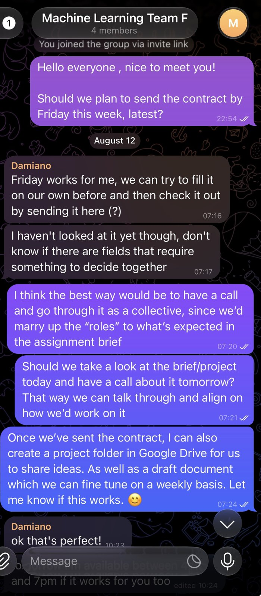
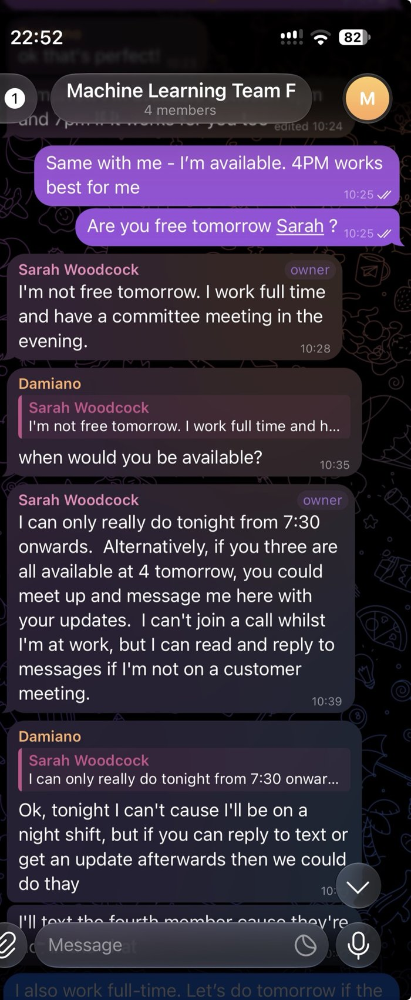
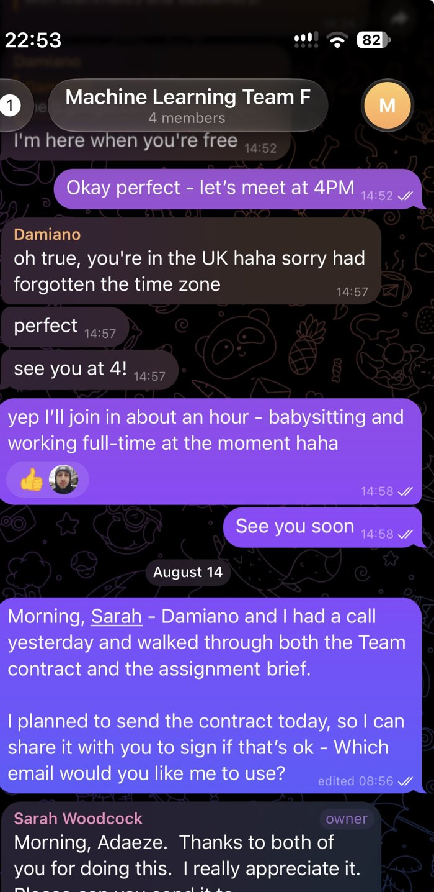
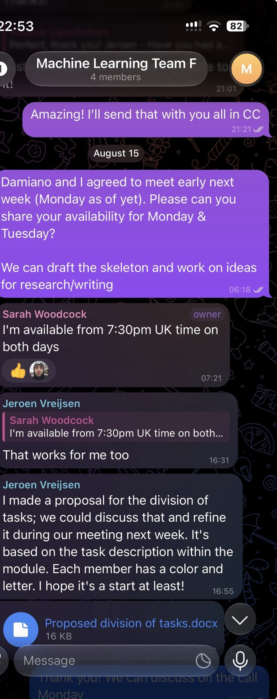

# Team collaboration evidence

[← Back to team project](../README.md)

Our team of four worked across different countries and around full-time jobs, so most coordination happened on Telegram. These screenshots are from the first week of the project (August 2026).

The screenshots show my role in getting the team started. I opened the discussion about the group contract and its deadline, suggested walking through the brief together on a call instead of filling the contract in separately, and offered to set up a shared Google Drive folder and a draft document for weekly refinement.

Finding a time to meet was hard: one member worked full time with evening commitments, another worked night shifts, and we were in different time zones. We agreed that members who could not join a call would receive written updates afterwards.

After the call, I shared the contract with the team for signing and submitted it to the tutor with everyone copied.

I then arranged the next planning meeting. A teammate proposed a division of tasks, which we refined together, and through this process I took ownership of the clustering section.

## Team contract

📄 [Team contract](05-team-contract.pdf) (signed 13–14 August 2026)

The contract set out our goals, expectations and roles. I was named joint Project Lead and Coordinator with Sarah, responsible for progress, deadlines and meetings. This matches the coordinating role shown in the screenshots above.

## Meeting notes

📄 [Meeting notes](06-meeting-notes.pdf)

I took the notes for Weeks 1 and 2, and Sarah took over from the 25 August catch-up onwards. The Week 2 notes record how the work was divided: Jeroen prepared the data, then passed it to Damiano and me for the regression and clustering, and Sarah researched each model, built the reference list and made the report structure consistent. The 25 August notes include the action for me to complete the clustering and pass it to Sarah so she could assemble the report. They also record a team debate about whether a train/validation split was needed for regression, which we resolved by going back to the course textbook.

## My clustering draft

📄 [Clustering section draft](07-clustering-section-draft.pdf)

This is the draft I wrote and shared with the team. It contains my analysis, figures, choice of *k* and cluster profiles, with **[REF]** markers where Sarah later added sources for the final report. It shows both my individual ownership of the section and the hand-over workflow agreed in Week 2.

**What this shows:** in a virtual team, coordination is real work. Agreeing ways of working early, and keeping absent members updated in writing, mattered as much as the analysis itself.
