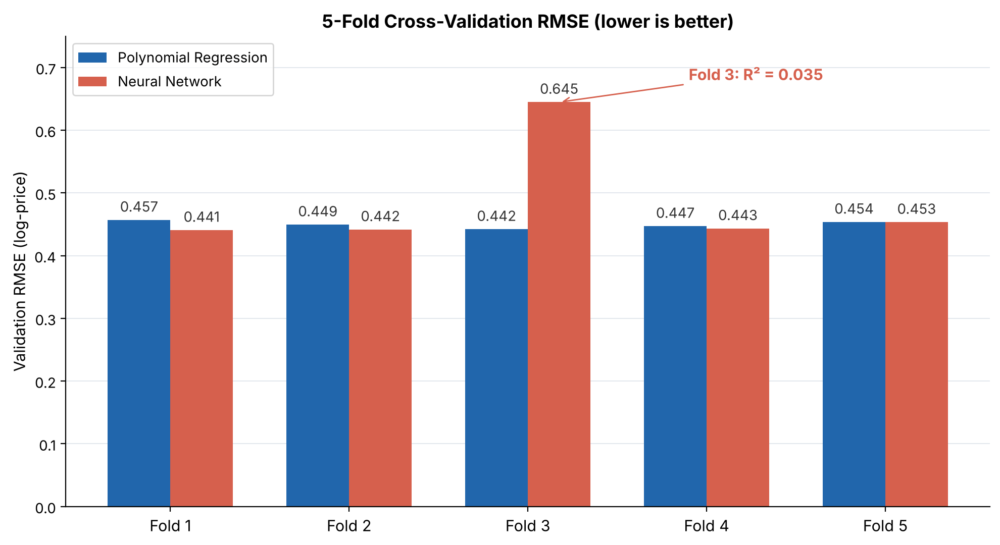
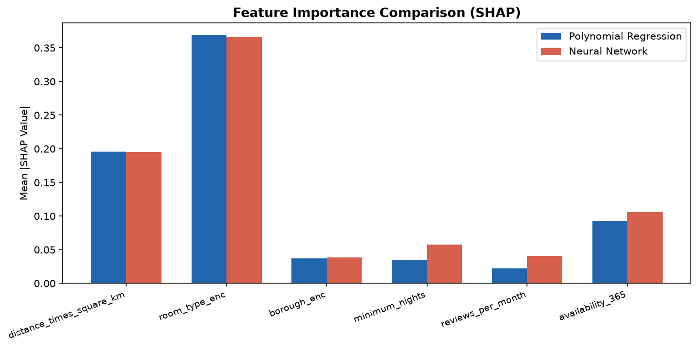
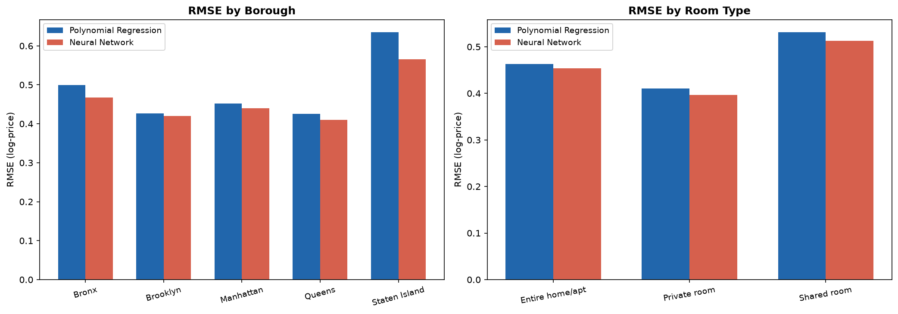

# Unit 11 - Individual Project: Classical ML vs Deep Learning

[← Back to e-portfolio](../../README.md)

📓 [Notebook](airbnb_ml.ipynb) · 📝 [Presentation transcript](Presentation_Transcript.docx) · 📊 [Dataset](AB_NYC_2019_prepared_with_distance.csv)

## The project

I compared degree-2 polynomial regression (scikit-learn) with a feedforward neural network (PyTorch) for predicting nightly Airbnb prices, framed as a price recommender for hosts. Both models were evaluated with 5-fold cross-validation and a hold-out test set, explained with SHAP, and checked for bias across boroughs and room types.

## Results

| Model | Test RMSE | Test R² | 5-fold CV RMSE |
|---|---|---|---|
| Polynomial regression | 0.442 | 0.553 | 0.450 ± 0.005 |
| Neural network | **0.430** | **0.577** | 0.485 ± 0.080 |

*Validation RMSE for each fold. The network failed on fold 3 (R² = 0.035).*

## Decisions I made, and why

**Recommending the less accurate model.** The network won on the test set, but only by about one percentage point of error, and one of its five training runs failed. I recommended polynomial regression because reliability and auditability matter more than a marginal gain in a tool that affects hosts' income.

**Explaining both models the same way.** I used Kernel SHAP for both, with the same background and test samples, so the comparison was fair. Both models ranked room type first and distance second.

**Checking who the model fails.** Error was highest for the smallest groups: Staten Island (371 listings), the Bronx and shared rooms. This turned a technical metric into an ethical finding.

## Limitations identified

The neural network had no early stopping, and its cross-validation runs trained for 30 epochs while the test model trained for 50. Label encoding implied an order between boroughs that does not exist. Framing price prediction as a "recommender" fitted the brief's Track B only loosely.
