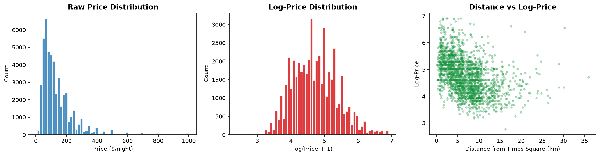

# Unit 2 - Exploratory Data Analysis

[← Back to e-portfolio](../README.md) · **LO2**

**Artefacts:** EDA from the [team project](../projects/unit-06-team-project/) and the [individual project](../projects/unit-11-individual-presentation/)

In the team project, EDA showed median prices falling from $185 within 2 km of Times Square to about $75 beyond 10 km, with a slight rise after 20 km. We knew the relationship was not linear before building any model.

In Unit 11, EDA drove two preparation decisions. Raw prices were heavily right-skewed, so I log-transformed them, and I removed zero prices and listings above $1,000 (about 0.5% of the data).

**What I learned:** EDA is where modelling decisions are made, not just where data is described.
