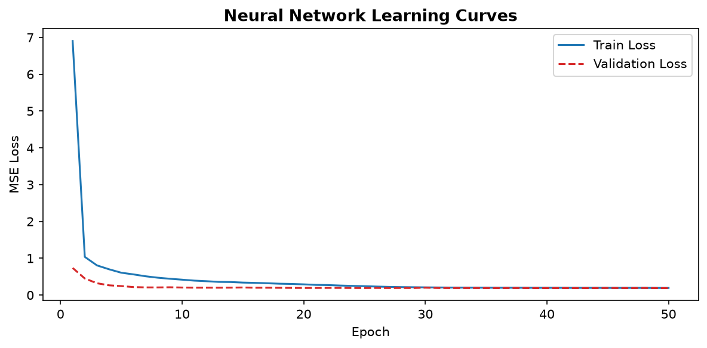

# Unit 8 - Training an Artificial Neural Network

[← Back to e-portfolio](../README.md) · **LO3**

**Artefact:** Learning curves and a failed training run ([individual project](../projects/unit-11-individual-presentation/))

The network was trained with backpropagation and the Adam optimiser (Kingma and Ba, 2015). The learning curves converged without overfitting. Cross-validation, however, revealed that one of five training runs failed (R² = 0.035), most likely because of an unlucky random initialisation combined with a fixed number of epochs and no early stopping.

**What I learned:** a single good training run can hide instability. Repeating training across folds or random seeds is part of evaluating a neural network.
